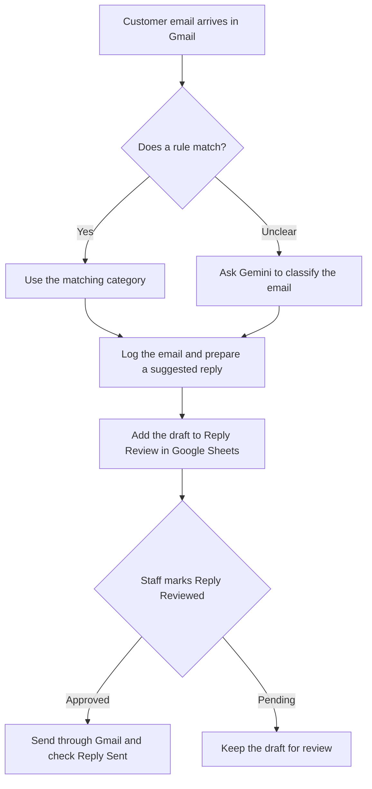

# Skin Care X — Customer Email Desk

Skin Care X is an n8n portfolio demo for a fictional skincare business. It sorts incoming customer emails, prepares suggested replies, and lets staff approve each reply in Google Sheets before Gmail sends it.

## How it works

## What the team sees

| Step | What happens |
| --- | --- |
| Intake | n8n fetches the full Gmail message and logs it in Google Sheets. |
| Classification | Rules handle clear requests such as order status or returns. Gemini classifies messages without a clear match. |
| Review | Staff can read the original email and edit the suggested reply in the **Reply Review** tab. |
| Send | The send workflow checks for approved rows, sends the reply through Gmail, and marks **Reply Sent** on the corresponding row. |

## Demo checks

- A test order-status email followed the rules-based route.
- The workflow fetched the full message body for logging and review.
- Approving a draft triggered the Gmail reply and updated the review row.

## Business value

The workflow cuts down on manual inbox sorting and gives staff a draft to edit. Staff still decide what goes out, and the review sheet gives them one place to see which replies are pending or sent.

**Tools:** n8n, Gmail, Google Sheets, and Gemini.

This repository documents the demo. A client rollout would connect the client's own inbox, spreadsheet, and Gemini account, then verify the approval and send flow with an internal test.
